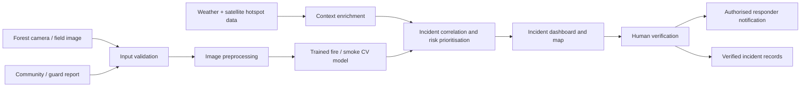

# ForestGuard — Forest Fire Detection

**Course:** Environmental Studies and E-Waste Management  
**Course code:** BCS508 · **Semester:** V · **Branch:** ISE/CSE  
**Selected environmental problem:** Forest Fire Detection  
**Project type:** Student web prototype and proposed digital architecture

## 1. Problem statement

Forest fires can damage forest cover, wildlife habitats and biodiversity, degrade air quality, and release greenhouse gases. A delayed report can allow a small incident to spread before responders can investigate. ForestGuard proposes a digital early-warning workflow that combines field observations, forest imagery and contextual data so that possible incidents can be prioritised for human verification.

## 2. Why this problem matters

- Fires can destroy vegetation and wildlife habitat.
- Smoke and particulate matter affect air quality and human health.
- Large fires can release substantial stored carbon.
- Remote forest locations can make observation and reporting difficult.
- Structured incident records can help identify recurring hotspots and improve prevention planning.

## 3. Proposed digital solution

ForestGuard is a proposed forest-fire observation and alert-support system. It has two input routes:

1. **Image screening:** a user or authorised field worker submits a forest photograph. In a production version, a computer-vision model trained on labelled fire, smoke and normal forest images would estimate the likelihood of visible fire/smoke.
2. **Field incident reporting:** a user submits the observation type, location, time and optional notes. The application validates and stores the report.

The proposed backend would combine image/model outputs with report location and weather/remote-sensing context. It would place candidate incidents in a dashboard so an authorised human reviewer can verify them and escalate them through official channels.

### What this repository currently implements

The published browser prototype includes:
- Responsive ForestGuard landing page and system explanation.
- Local image upload and preview.
- An explicitly labelled **demo colour-pixel heuristic** to demonstrate an image-processing interaction.
- Field report form with coordinate validation and browser-session storage.
- Input → Processing → Output workflow and a conceptual architecture diagram.

**Important limitation:** The current prototype does not contain a trained AI/ML model, a live satellite feed, a backend, a GIS map, automatic alerts or emergency dispatch. The image heuristic is not an actual fire classifier; sunlight, soil and other objects can produce similar colours. A low score does not prove that a scene is safe. Do not use this prototype for emergency decisions. For real incidents, contact the relevant local emergency or forest department directly.

## 4. Technologies used

| Technology | Purpose |
|---|---|
| HTML5 | Page structure, form and semantic content |
| CSS3 | Responsive interface and visual design |
| JavaScript | Image preview, demo pixel analysis, validation and session storage |
| Computer Vision (proposed) | Detect visible fire and smoke in submitted images using a trained model |
| Machine Learning (proposed) | Train and validate a classifier/detector on labelled fire, smoke and normal-scene data |
| GIS (proposed) | Plot reports, analyse location context and identify possible hotspots |
| Cloud/backend (proposed) | Securely store reports and model results; distribute authorised alerts |

For the assignment form, select **Web Application** as implemented. Select **Computer Vision**, **Machine Learning**, **GIS**, or **Cloud Computing** only when describing the proposed/extended system; these capabilities are not yet implemented in this static demo. Do not claim the current page uses a trained AI model.

## 5. Input data required and possible sources

| Input | Required fields | Possible source |
|---|---|---|
| Forest images | Image pixels, capture time, approximate location | Forest staff/mobile field reports; authorised camera traps or lookout cameras |
| Fire/smoke labels | Image-level or bounding-box labels: fire, smoke, normal | Manually verified images; openly licensed research datasets |
| Incident report | Incident type, description, timestamp, latitude/longitude | Forest guards, local communities, authorised users |
| Weather | Temperature, humidity, wind speed/direction, rainfall | India Meteorological Department (IMD), where accessible |
| Satellite/thermal observations | Hotspot coordinates, acquisition time, confidence/quality | NASA FIRMS and other authorised remote-sensing products |
| Forest geography | Forest boundary, vegetation and protected-area layers | Relevant state forest department and authorised GIS/open geospatial data |

Data quality, licences, geographic coverage and access terms must be checked before operational use. Reports from the public need verification to prevent false alarms and misuse.

## 6. How the system works: Input → Processing → Output

### Input
- Field photograph or camera image.
- Optional incident report with coordinates and time.
- Contextual weather and satellite hotspot observations (proposed integration).

### Processing
1. Validate image format, report fields and coordinate ranges.
2. Preprocess an image to the input size expected by the trained model.
3. Run a fire/smoke object-detection or image-classification model.
4. Combine the model output with time, location and available context.
5. Prioritise possible incidents and send them to a human verification queue.
6. Record the reviewer outcome to support auditing and future model improvement.

### Output
- Candidate incident with image, location, timestamp and model score.
- Map/dashboard view and prioritised review queue.
- Human-reviewed incident status and an alert to authorised responders through an approved channel.

### What the demo does today
The browser demo only performs steps 1 (basic local image loading) and a deliberately simple colour-pixel heuristic for demonstration. It can save a report in the current browser session. It does not execute the proposed ML/GIS/backend steps above.

## 7. Expected environmental benefits

1. **Earlier detection and investigation:** multiple observation channels can help identify possible fires earlier.
2. **Reduced spread and damage:** faster verification and response may limit the area burned.
3. **Biodiversity protection:** reducing fire damage helps protect trees, wildlife and forest habitats.
4. **Reduced air pollution and emissions:** preventing large fires can reduce smoke, particulate matter and greenhouse-gas release.
5. **Better prevention planning:** historical, verified reports can reveal hotspots and support targeted forest management.

These are expected benefits of a successful operational deployment, not measured outcomes of this student prototype.

## 8. System architecture



## 9. Run the prototype

No package installation or build step is required.

1. Clone or download this repository.
2. Open the project folder.
3. Open `index.html` in a modern browser.

Or serve it locally:

```bash
python3 -m http.server 8000
```

Then visit [http://localhost:8000](http://localhost:8000).

## 10. Suggested demonstration

1. Open the web page and explain that ForestGuard addresses forest fire detection.
2. Scroll to **Check a forest image** and upload any test image.
3. Run the demo screening. Explain that it is a colour heuristic only, not a trained AI model.
4. Submit a sample field report with both coordinates or leave both blank.
5. Explain the proposed production pipeline using the Input → Processing → Output section.
6. Present the five expected environmental benefits and the limitations.

## 11. Future scope

- Train and evaluate an image model on a labelled, geographically diverse dataset.
- Report precision, recall, F1-score and false-negative rates; prioritise reducing missed fires.
- Integrate verified satellite hotspot feeds and local weather data.
- Add a GIS dashboard with forest boundaries and report clustering.
- Implement secure authentication, backend storage, audit logs and role-based access.
- Add offline report capture and synchronisation for areas with weak connectivity.
- Test with forest officials and conduct field validation before any operational deployment.

## 12. References and data resources

- NASA Fire Information for Resource Management System (FIRMS): https://firms.modaps.eosdis.nasa.gov/
- India Meteorological Department: https://mausam.imd.gov.in/
- NASA Earthdata: https://www.earthdata.nasa.gov/
- FAO — Forests: https://www.fao.org/forests/
- MDN — HTML, CSS and JavaScript documentation: https://developer.mozilla.org/

Check current availability, usage terms and attribution requirements before using external datasets or services.

---

**Prepared as a BCS508 Environmental Studies student prototype.**  
ForestGuard is an educational demonstration, not a certified fire-detection system or emergency-response service.
