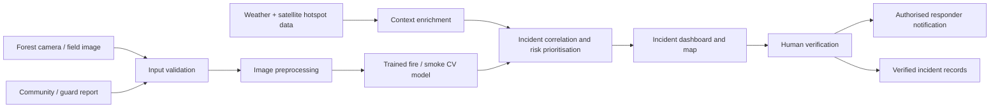

# ForestGuard — Forest Fire Detection

**Course:** Environmental Studies and E-Waste Management  
**Course code:** BCS508 · **Semester:** V · **Branch:** ISE/CSE  
**Selected environmental problem:** Forest Fire Detection  
**Project type:** Interactive browser-based operations prototype and proposed digital architecture

## 1. Problem statement

Forest fires can damage forest cover, wildlife habitats and biodiversity, degrade air quality, and release greenhouse gases. A delayed report can allow a small incident to spread before responders can investigate. ForestGuard proposes a digital early-warning workflow that combines field observations, forest imagery and contextual data so that possible incidents can be prioritised for human verification.

## 2. Why this problem matters

- Fires can destroy vegetation and wildlife habitat.
- Smoke and particulate matter affect air quality and human health.
- Large fires can release substantial stored carbon.
- Remote forest locations can make observation and reporting difficult.
- Structured incident records can help identify recurring hotspots and improve prevention planning.

## 3. Proposed digital solution

ForestGuard is a proposed forest-fire observation and alert-support system. It has two input routes:

1. **Image screening:** a user or authorised field worker submits a forest photograph. In a production version, a computer-vision model trained on labelled fire, smoke and normal forest images would estimate the likelihood of visible fire/smoke.
2. **Field incident reporting:** a user submits the observation type, location, time and optional notes. The application validates and stores the report.

The proposed backend would combine image/model outputs with report location and weather/remote-sensing context. It would place candidate incidents in a dashboard so an authorised human reviewer can verify them and escalate them through official channels.

### What this repository currently implements

The repository now includes a functional browser-based demonstration with two pages:

- **Landing page:** project overview, assignment workflow, system architecture and environmental benefits.
- **Operations dashboard (`dashboard.html`):** incident queue, report creation, priority calculation, status updates, coordinate plot, weather-risk slider, image screening and CSV export.
- **Persistent local data:** reports are stored in the browser's `localStorage`, so they remain after a refresh on the same browser/device.
- **Sample data:** load three illustrative reports to demonstrate the queue, priorities and map pins.
- **Filtering:** search incidents and filter by status or priority.
- **Human review workflow:** move an incident between Open, Under review, Verified and False alarm.
- **Image screening:** local pixel-colour heuristic with explicit limitations; no image is sent to a server.
- **Responsive interface:** desktop and mobile layouts.

### Implemented processing logic

The prototype computes an illustrative priority score from the report type, temperature, wind speed and humidity. It assigns Low, Medium or High priority and supports human status updates. The weather panel independently calculates an educational fire-weather indicator from manually entered conditions. These scores are transparent rules for demonstrating the data flow, not scientifically calibrated fire-risk models.

**Important limitation:** This is a complete interactive front-end prototype, not a production fire-detection service. It does not contain a trained AI/ML model, live satellite feed, live weather API, cloud database, multi-user authentication, real GIS basemap or automatic emergency dispatch. The image heuristic is not an actual fire classifier; sunlight, soil and other objects can produce similar colours. A low score does not prove that a scene is safe. Browser data is local to one device and is not shared with responders. Do not use this prototype for emergency decisions. For real incidents, contact the relevant local emergency or forest department directly.

## 4.1 Run the full prototype

1. Clone the repository.
2. Open `index.html` for the project introduction.
3. Select **Open live dashboard** or open `dashboard.html` directly.
4. Select **Load sample data** to populate the incident queue and coordinate plot.
5. Create a report with an observation type and optional latitude/longitude.
6. Change report status in the queue, filter/search reports, and export the queue as CSV.
7. Use the image screening panel to test a local image.

No build step, API key, package installation or backend is required. Run from a local static server for the most consistent browser behaviour:

```bash
python3 -m http.server 8000
```

Open [http://localhost:8000](http://localhost:8000), then launch the dashboard.

## 4. Technologies used

| Technology | Purpose |
|---|---|
| HTML5 | Page structure, form and semantic content |
| CSS3 | Responsive interface and visual design |
| JavaScript | Incident queue, local persistence, heuristic priority scoring, image pixel analysis, filters and CSV export |
| Computer Vision (implemented pipeline; weights must be trained/supplied) | YOLO fire/smoke object detection, bounding boxes and confidence scores |
| Machine Learning (training code included; training not yet run) | YOLO training, held-out evaluation and image prediction scripts |
| GIS (proposed) | Plot reports, analyse location context and identify possible hotspots |
| Cloud/backend (proposed) | Securely store reports and model results; distribute authorised alerts |

For the assignment form, select **Web Application** as implemented. You can describe Computer Vision and Machine Learning as an implemented training/inference pipeline, but do not claim a trained detector is already operational until a dataset has been prepared, training has completed, and the API reports that model weights are loaded. GIS and cloud deployment remain proposed/partial integrations.

## 4.2 Machine-learning model and API

ForestGuard now includes a YOLO-based fire/smoke object-detection training pipeline and a FastAPI inference service.

**ML code:** `ml/train.py`, `ml/evaluate.py`, `ml/predict.py`  
**Backend:** `backend/app/main.py`  
**Dashboard integration:** The Image Screening panel sends the selected image to `POST /api/detect`. Set the API endpoint in the dashboard. The browser does not fabricate model predictions: if the API or trained checkpoint is unavailable, the interface reports that the service is unavailable.

### Dataset and training

Use the D-Fire dataset as a starting point. It contains more than 21,000 images with fire/smoke bounding-box annotations and a no-fire category. Download and review the dataset terms and original-source attributions from the [official D-Fire repository](https://github.com/gaia-solutions-on-demand/DFireDataset). Its public README describes the image counts, YOLO annotation format, download options and source-specific attribution requirements.

1. Download and extract D-Fire locally. Do not commit dataset images or model weights.
2. Install `ml/requirements.txt`.
3. Copy `ml/data.yaml.example` to `ml/data.yaml`.
4. Set the dataset paths and verify the numeric class-ID mapping against the actual downloaded labels before training.
5. Train: `python ml/train.py --data ml/data.yaml --epochs 80 --imgsz 640 --batch 8`.
6. Evaluate on the held-out test split: `python ml/evaluate.py --weights ml/runs/detect/forestguard/weights/best.pt --data ml/data.yaml`.
7. Run local inference: `python ml/predict.py --source path/to/image.jpg --save`.

The best checkpoint is written to `ml/runs/detect/forestguard/weights/best.pt`. The repository does not contain a trained checkpoint or dataset, so the ML endpoint will remain in model-not-loaded state until you train or supply weights.

### Run the API

```bash
pip install -r backend/requirements.txt
uvicorn backend.app.main:app --reload --port 8000
```

API docs: [http://localhost:8000/docs](http://localhost:8000/docs)  
Health: [http://localhost:8000/health](http://localhost:8000/health)

Set `MODEL_PATH` to the trained checkpoint. The default points to the ML training output. The API provides image detection and SQLite-backed incident CRUD/status endpoints. See `backend/README.md` and `ml/README.md` for deployment and detailed setup.

**Deployment separation:** GitHub Pages can host the static frontend, but it cannot run FastAPI or PyTorch inference. Deploy the API separately to a Python/Docker host, configure the dashboard's API URL to that service, and provide the model weights through a private artifact or mounted volume. Restrict CORS to the real frontend origin for production.

**Safety and evaluation:** YOLO confidence scores are not calibrated probabilities. Evaluate precision, recall, mAP50 and mAP50-95 on held-out data; inspect false negatives; and validate on local forest conditions. This is a research prototype, not an official alerting or emergency-response system.

## 5. Input data required and possible sources

| Input | Required fields | Possible source |
|---|---|---|
| Forest images | Image pixels, capture time, approximate location | Forest staff/mobile field reports; authorised camera traps or lookout cameras |
| Fire/smoke labels | Image-level or bounding-box labels: fire, smoke, normal | Manually verified images; openly licensed research datasets |
| Incident report | Incident type, description, timestamp, latitude/longitude | Forest guards, local communities, authorised users |
| Weather | Temperature, humidity, wind speed/direction, rainfall | India Meteorological Department (IMD), where accessible |
| Satellite/thermal observations | Hotspot coordinates, acquisition time, confidence/quality | NASA FIRMS and other authorised remote-sensing products |
| Forest geography | Forest boundary, vegetation and protected-area layers | Relevant state forest department and authorised GIS/open geospatial data |

Data quality, licences, geographic coverage and access terms must be checked before operational use. Reports from the public need verification to prevent false alarms and misuse.

## 6. How the system works: Input → Processing → Output

### Input
- Field photograph or camera image.
- Optional incident report with coordinates and time.
- Contextual weather and satellite hotspot observations (proposed integration).

### Processing
1. Validate image format, report fields and coordinate ranges.
2. Preprocess an image to the input size expected by the trained model.
3. Run a fire/smoke object-detection or image-classification model.
4. Combine the model output with time, location and available context.
5. Prioritise possible incidents and send them to a human verification queue.
6. Record the reviewer outcome to support auditing and future model improvement.

### Output
- Candidate incident with image, location, timestamp and model score.
- Map/dashboard view and prioritised review queue.
- Human-reviewed incident status and an alert to authorised responders through an approved channel.

### What the demo does today
The browser demo performs local image loading and a deliberately simple colour-pixel heuristic. The dashboard validates and stores incident reports locally, calculates transparent rule-based priority scores, plots submitted coordinates schematically, supports human status updates and exports reports to CSV. It does not execute the proposed trained-ML, live-GIS, weather-feed or backend steps above.

## 7. Expected environmental benefits

1. **Earlier detection and investigation:** multiple observation channels can help identify possible fires earlier.
2. **Reduced spread and damage:** faster verification and response may limit the area burned.
3. **Biodiversity protection:** reducing fire damage helps protect trees, wildlife and forest habitats.
4. **Reduced air pollution and emissions:** preventing large fires can reduce smoke, particulate matter and greenhouse-gas release.
5. **Better prevention planning:** historical, verified reports can reveal hotspots and support targeted forest management.

These are expected benefits of a successful operational deployment, not measured outcomes of this student prototype.

## 8. System architecture



## 9. Run the prototype

No package installation or build step is required.

1. Clone or download this repository.
2. Open the project folder.
3. Open `index.html` in a modern browser.

Or serve it locally:

```bash
python3 -m http.server 8000
```

Then visit [http://localhost:8000](http://localhost:8000).

## 10. Suggested demonstration

1. Open the landing page and launch the operations dashboard.
2. Click **Load sample data** to populate the dashboard.
3. Demonstrate the priority metrics, coordinate plot, incident search and status changes.
4. Create a new report and show that it persists after refreshing the page.
5. Export the incident queue to CSV.
6. Upload a photo and run the clearly labelled pixel-colour heuristic.
7. Explain the proposed production pipeline, expected benefits and limitations.

## 11. Future scope

- Train and evaluate an image model on a labelled, geographically diverse dataset.
- Report precision, recall, F1-score and false-negative rates; prioritise reducing missed fires.
- Integrate verified satellite hotspot feeds and local weather data.
- Replace the schematic coordinate plot with a real GIS basemap and authorised forest-boundary layers.
- Implement secure authentication, backend storage, audit logs and role-based access.
- Add offline report capture and synchronisation for areas with weak connectivity.
- Test with forest officials and conduct field validation before any operational deployment.

## 12. References and data resources

- NASA Fire Information for Resource Management System (FIRMS): https://firms.modaps.eosdis.nasa.gov/
- India Meteorological Department: https://mausam.imd.gov.in/
- NASA Earthdata: https://www.earthdata.nasa.gov/
- FAO — Forests: https://www.fao.org/forests/
- MDN — HTML, CSS and JavaScript documentation: https://developer.mozilla.org/

Check current availability, usage terms and attribution requirements before using external datasets or services.

---

**Prepared as a BCS508 Environmental Studies student prototype.**  
ForestGuard is an educational demonstration, not a certified fire-detection system or emergency-response service.
